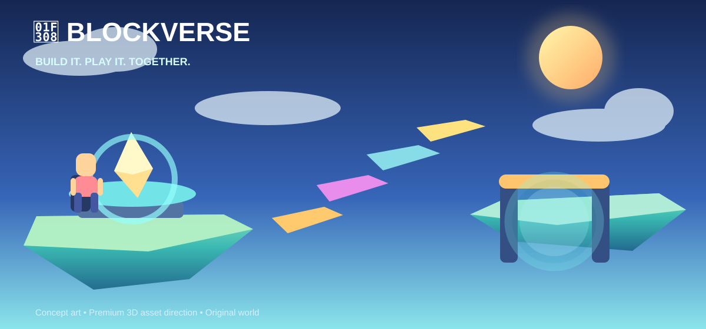
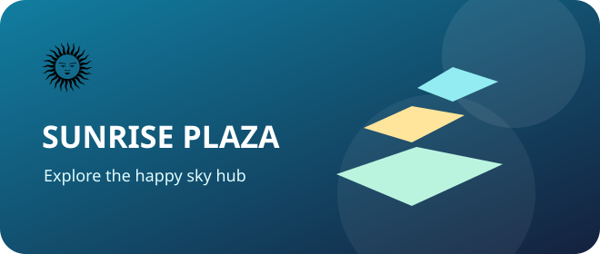
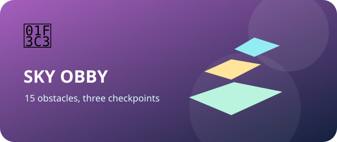
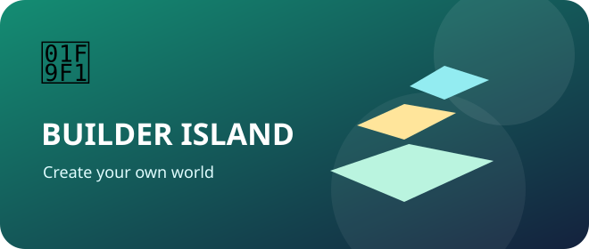
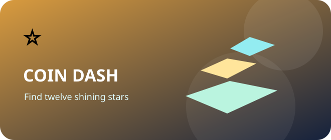
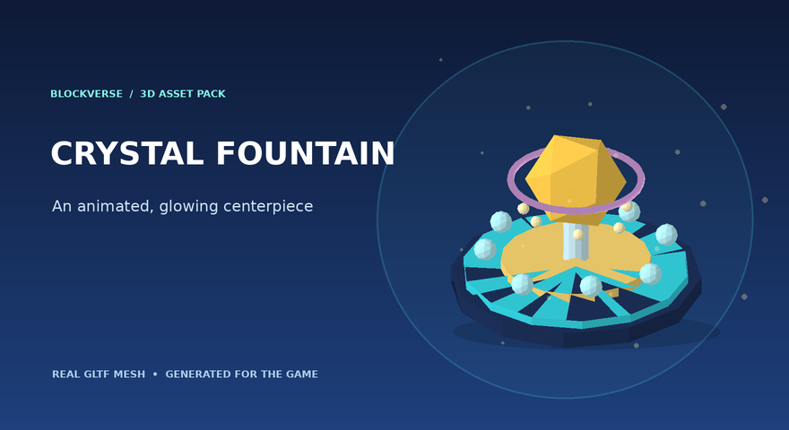
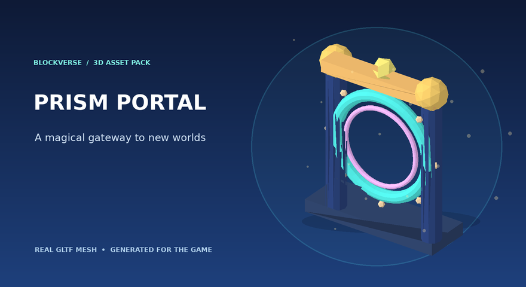
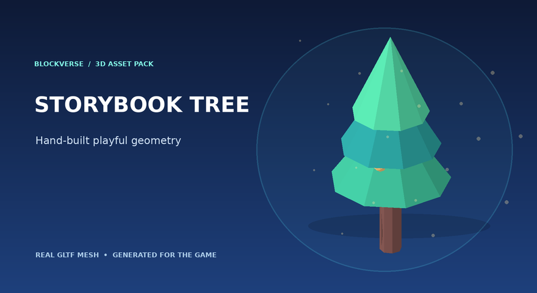
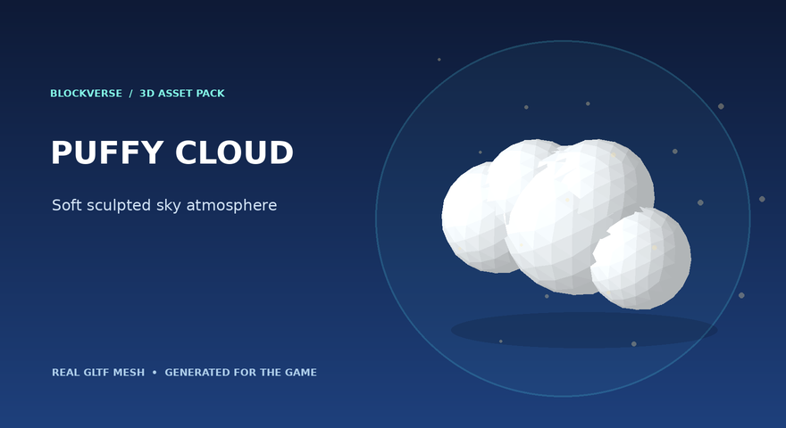

<div align="center">



# 🌈 BLOCKVERSE

### 🧱 Bangun duniamu • 🏃 Taklukkan tantangan • 🎉 Main bareng teman!

**Game sandbox 3D orisinal di browser, dibuat untuk petualang, pembangun, dan penjelajah muda.**

   

**[🎮 Mulai main](#-cara-menjalankan-game) · [🧑‍🤝‍🧑 Main bersama](#-cara-main-multiplayer) · [🛠️ Editor dunia](#-pilihan-dunia) · [🖥️ Jalankan server VPS](#-multiplayer-di-vps) · [🔒 Keamanan](#-catatan-keamanan-dan-status-proyek)**

</div>

---

## 🌟 Selamat datang di BLOCKVERSE!

Pilih avatar blocky paling keren, melompat di antara pulau melayang, membuat taman, dan bertemu teman satu ruangan! ☁️🌞

> 🎨 **Tentang gambar:** Banner dan kartu di bawah adalah ilustrasi konsep, **bukan screenshot hasil permainan**. Bagian 3D asset pack adalah **preview hasil render mesh glTF asli** yang turut disertakan dalam repository.

## 🗺️ Pilihan dunia

| ☀️ Dunia | 🧭 Petualangan |
|---|---|
|  | **🌞 Sunrise Plaza**: pusat pertemuan, air mancur kristal, portal ajaib, pepohonan. |
|  | **🏃 Sky Obby**: 15 rintangan, 3 checkpoint, timer, dan rekor personal. |
|  | **🧱 Builder Island**: letakkan balok, cat, rotasi, ukuran, undo/redo, dan tes duniamu sendiri. |
|  | **⭐ Coin Dash**: ambil 12 bintang secepat mungkin! |

## ✨ Asset 3D baru, benar-benar model 3D!

Model di bawah ini bukan gambar latar 2D. Repository berisi **mesh glTF 2.0 & GLB** yang dimuat ke scene 3D Three.js menggunakan `GLTFLoader`. Ada material warna, model bercabang, bentuk portal, dan beberapa komponen yang bisa dilihat dari sisi lain saat kamera bergerak. 🎨

| 🌟 Crystal Fountain | 🌀 Prism Portal |
|---|---|
|  |  |
| 🌳 Storybook Tree | ☁️ Puffy Cloud |
|  |  |

**Asset source:** `public/assets/3d/*.gltf` dan `*.glb`. Semua dibuat khusus untuk BLOCKVERSE menggunakan geometri prosedural. Scene lama dan collision-nya tetap dipertahankan sebagai fallback jika file glTF gagal dimuat.

### 🎮 Kontrol petualang

| Gerakan | Tombol |
|---|---|
| 🏃 Jalan | `W A S D` / panah |
| 💨 Lari cepat | `Shift` |
| 🪂 Lompat | `Space` |
| 🎥 Kamera | Tarik mouse dan scroll |
| 🌀 Masuk portal | `E` |
| 👋 Emote aman | `Q` |
| 🔄 Respawn | `R` |
| 🧱 Mode uji Builder | `B` |
| ↩️ Undo / redo | `Ctrl+Z` / `Ctrl+Y` |

📱 **HP/tablet:** joystick sentuh dan tombol aksi tersedia, tetapi uji UX & performa perangkat nyata masih diperlukan.

## 🧑‍🤝‍🧑 Cara main multiplayer

**Jika server VPS sudah dijalankan dan `VITE_MULTIPLAYER_URL` dikonfigurasi**:

1. Buka URL BLOCKVERSE yang sudah dideploy di browser 💻📱
2. Masukkan **kode room yang sama**, contohnya `FRIENDS1`.
3. Pilih dunia yang sama, seperti Sunrise Plaza ☀️
4. Lihat avatar teman berjalan, berputar, dan mengirim 6 pilihan emote 👋
5. Batas per room di server: **16 koneksi/pemain**.

Server menerima koneksi WebSocket `wss://`, memiliki daftar origin yang diizinkan, batas ukuran paket, rate limit gerakan dan emote, heartbeat, pembersihan room kosong, dan menolak room yang sudah penuh.

**Tanpa VPS:** game tetap bisa dimainkan sendiri; tab pada satu browser/origin bisa berkomunikasi melalui `BroadcastChannel`. Firebase optional untuk profil/world, tetapi bukan pengganti server pertandingan VPS.

⚠️ Ini **belum server-authoritative physics atau anti-cheat kompetitif**. Server mengatur anggota room dan relai posisi; reward/Stars masih progres DEMO lokal. Sistem akun anak, moderasi, leaderboard publik, monetisasi, dan gameplay kompetitif *belum siap untuk rilis publik*. 

## 🚀 Cara menjalankan game

Butuh **Node.js 20+** dan npm.

```bash
git clone https://github.com/adith92/blockverse.git
cd blockverse
npm install
cp .env.example .env.local
npm run dev
```

Buka `http://localhost:5173`. Karena repo **private**, gunakan GitHub login atau kredensial Git sendiri yang sah.

Perintah:

```bash
npm run test:unit         # 🧪 validasi gameplay dan schema
npm run build             # 📦 build frontend Vite
npm run preview           # 🔎 cek output produksi
npm run test:rules:emulator  # 🔐 uji Firestore rules (Java diperlukan)
node --test server/tests/*.test.mjs  # 🧰 validasi server
```

## 🖥️ Multiplayer di VPS

Arsitektur:

```text
  🧒 Browser A          👧 Browser B          🧑 Browser C
     │                       │                       │
     └──────── HTTPS game frontend (Vercel) ─────────┘
                             │
           WSS multiplayer URL (VITE_MULTIPLAYER_URL)
                             │
                  🔐 Caddy reverse proxy
                             │
               🖥️ Node WebSocket on VPS:3001
                             │
                  👥 Rooms (max 16/room)
```

Cara cepat untuk VPS Ubuntu + Docker:

```bash
# Di VPS setelah clone repo private dan pasang Docker + Docker Compose
cd blockverse/infra
cp .env.example .env
# Edit .env: MULTIPLAYER_DOMAIN dan ALLOWED_ORIGINS sesuai domain asli.
docker compose up -d --build
```

Setelah DNS `multiplayer.domainmu.com` mengarah ke IP VPS, Caddy membuat TLS HTTPS/WSS otomatis. Pastikan port **80/443 TCP** bisa diakses dan tidak ada firewall yang memblokir. Server merespons `https://multiplayer.domainmu.com/healthz` dan WebSocket `wss://multiplayer.domainmu.com/ws`.

Di frontend Vercel, set:

```dotenv
VITE_MULTIPLAYER_URL=wss://multiplayer.domainmu.com/ws
```

⚠️ **Jangan copy placeholder di atas apa adanya**. Gunakan domain sendiri dan set `ALLOWED_ORIGINS` hanya ke origin frontend yang tepercaya. Bila menggunakan custom domain untuk server, sesuaikan Content-Security-Policy Vercel di `vercel.json` juga. Lihat [panduan VPS lengkap](docs/VPS_MULTIPLAYER.md) dan [deployment](DEPLOYMENT.md).

## 🔒 Catatan keamanan dan status proyek

- 🧸 **Tanpa chat bebas:** emote memakai kode pesan tetap. Tidak mengizinkan upload script bebas.
- 🔐 **Firebase:** Jika diaktifkan, gunakan Anonymous Auth dan *deploy* `firestore.rules` untuk proteksi profil/world. Jangan pernah memasukkan service account ke variabel frontend `VITE_`.
- 🛡️ **WebSocket:** server menentukan ID pemain, room dan kapasitas, bukan browser. Client positions masih belum diverifikasi lewat server physics.
- 🚦 **Status saat ini: staging / testing.** Belum mengklaim 10/10 production atau berhasil multiplayer lintas lokasi sebelum pengujian VPS selesai. Tidak ada leaderboard, pembayaran, atau inventory server resmi.
- 🧑‍👧‍👦 **Anak-anak:** sebelum meluncurkan layanan publik bagi anak, perlu pengaturan usia, aturan keselamatan, pelaporan, moderasi, privasi anak, dan verifikasi kepatuhan hukum.

## 🧰 Isi repositori

```text
blockverse/
├── index.html                  🎮 UI dan layar game
├── src/game.js                 🏝️ Dunia, avatar, fisika, editor, multiplayer
├── src/schema.mjs              🔐 Validasi objek
├── public/assets/3d/          🎨 Asset glTF/GLB asli
├── docs/images/                🖼️ Galeri gambar & preview asset
├── server/                     🖥️ Multiplayer VPS Node WebSocket
├── infra/                      🐳 Docker Compose, Caddy, Dockerfile
├── tests/                      🧪 Tes schema dan Firestore
├── .github/workflows/ci.yml    ✅ CI
├── .env.example                ⚙️ Variabel konfigurasi publik
├── vercel.json                 ☁️ Deploy frontend
├── SECURITY.md                 🛡️ Security policy
└── RELEASE_CHECKLIST.md        📋 Kriteria rilis
```

## 💛 Untuk para kreator kecil

> Setiap pulau dimulai dari satu balok. Setiap petualangan dimulai dari satu lompatan. 🌟

**BLOCKVERSE adalah proyek game orisinal independen dan tidak berafiliasi dengan Roblox.** Semua desain aset dibuat baru untuk proyek ini. Hak pakai aset pihak ketiga, lisensi dependency, dan keamanan hosting tetap perlu ditinjau sebelum rilis publik.

<div align="center"><b>🌈 BUILD IT. PLAY IT. TOGETHER. 🌈</b></div>
